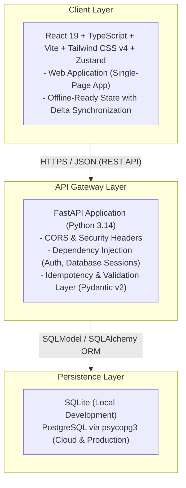

# Focus Technical Documentation

This directory contains the complete technical documentation for the Focus application, covering both the backend services and the frontend client interface.

---

## Documentation Structure

The documentation is organized into modular documents addressing specific subsystems, architectural decisions, and operational guides:

1. [Backend Architecture](file:///d:/Documents/My%20Code/pr-focus/documentation/backend-architecture.md)
   Architectural overview, layered service patterns, dependency injection mechanisms, module responsibilities, and request lifecycles.

2. [API Reference](file:///d:/Documents/My%20Code/pr-focus/documentation/api-reference.md)
   Complete specification for all REST endpoints across Authentication, Projects, Tasks, and Focus Sessions, including idempotency headers, pagination, and error responses.

3. [Database and Security](file:///d:/Documents/My%20Code/pr-focus/documentation/database-and-security.md)
   Relational data models, indexing strategy, soft-deletion cascading, connection pooling, Argon2id/Bcrypt cryptography, JWT lifecycles, and CORS policy enforcement.

4. [Frontend Architecture](file:///d:/Documents/My%20Code/pr-focus/documentation/frontend-architecture.md)
   Client-side architecture using React 19, TypeScript, Vite, and Tailwind CSS v4, detailing component hierarchy and modular decomposition.

5. [State Management and Services](file:///d:/Documents/My%20Code/pr-focus/documentation/state-and-services.md)
   Zustand store architecture, local persistence, delta synchronization protocol, API communication layer, sound cues, and keyboard shortcuts.

6. [Design System and UI](file:///d:/Documents/My%20Code/pr-focus/documentation/design-system-and-ui.md)
   Design principles, color palette tokens, typography rules, dark and light theme switching, the minimalist notification/toast subsystem, and core component specifications.

7. [Development and Deployment](file:///d:/Documents/My%20Code/pr-focus/documentation/development-and-deployment.md)
   Local development workflow with `uv` and `npm`, environment variable configuration, automated test suites, and production deployment procedures.

---

## System Overview

Focus is a full-stack personal productivity and time-management system designed around deep work methodologies (such as the Pomodoro technique and task-driven timeboxing).

### High-Level System Architecture

### Core System Principles

- Strict Separation of Concerns: The backend manages authentication, data consistency, multi-tenant isolation, and business logic. The frontend handles state presentation, user interaction, timer state, and caching.
- Zero Hardcoded Credentials: All secrets, database URLs, and environment variables are strictly loaded through environment variables and local `.env` files.
- Delta Synchronization: Both backend queries and frontend stores support timestamp-based delta sync (`updated_after`), allowing client applications to operate reliably across intermittent network connectivity.
- Deterministic Build Pipelines: The backend uses `uv` with `uv.lock`, while the frontend uses `npm` with clean TypeScript compiler checks (`tsc -b`).
