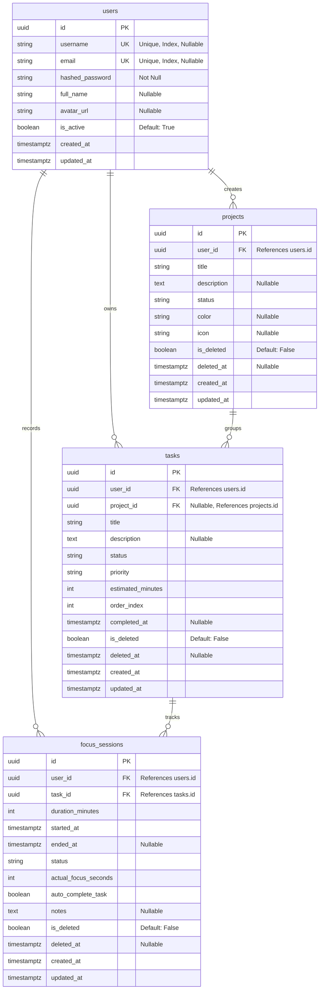

# Database and Security Specification

This document details the database schema, indexing strategy, data lifecycle management, cryptographic implementation, and security policies governing the Focus platform.

---

## 1. Relational Database Schema

The database schema is modeled using SQLModel (SQLAlchemy 2.0). All primary identifiers are UUIDv4 to eliminate enumeration vulnerabilities and facilitate offline ID generation by client applications.

### Entity-Relationship Overview



---

## 2. Table Specifications and Constraints

### `users` Table
- Stores user credentials and profile state.
- Supports flexible registration where either `username` or `email` can act as the unique primary handle.
- Indexes:
  - `ix_users_username` on `username` (UNIQUE)
  - `ix_users_email` on `email` (UNIQUE)

### `projects` Table
- Represents task groups, milestones, or goal buckets.
- Foreign Key: `user_id` references `users.id` on delete restrict.
- Indexes:
  - `ix_projects_user_id` on `user_id`
  - `ix_projects_status` on `status`
  - `ix_projects_is_deleted` on `is_deleted`

### `tasks` Table
- Represents discrete backlog work items.
- Foreign Keys:
  - `user_id` references `users.id`
  - `project_id` references `projects.id` (NULL allows standalone inbox tasks)
- Indexes:
  - `ix_tasks_user_id` on `user_id`
  - `ix_tasks_project_id` on `project_id`
  - `ix_tasks_status` on `status`
  - `ix_tasks_priority` on `priority`
  - `ix_tasks_is_deleted` on `is_deleted`

### `focus_sessions` Table
- Records individual timed focus periods, Pomodoro intervals, and completion notes.
- Foreign Keys:
  - `user_id` references `users.id`
  - `task_id` references `tasks.id`
- Indexes:
  - `ix_focus_sessions_user_id` on `user_id`
  - `ix_focus_sessions_task_id` on `task_id`
  - `ix_focus_sessions_status` on `status`
  - `ix_focus_sessions_is_deleted` on `is_deleted`

---

## 3. Data Lifecycle & Soft-Deletion Architecture

To protect against irreversible accidental data loss and support offline synchronization, entities are soft-deleted by default:

1. Deletion Flagging:
   Deleting an entity sets `is_deleted = True`, records the UTC timestamp in `deleted_at`, and updates `updated_at`.

2. Cascading Soft Deletions:
   - When a Project is deleted, all associated non-deleted Tasks are automatically marked `is_deleted = True`.
   - All associated Focus Sessions for those Tasks are similarly marked `is_deleted = True`.
   - When an individual Task is deleted, its associated Focus Sessions are marked `is_deleted = True`.

3. Query Isolation:
   Standard queries append `.where(Model.is_deleted == False)` unless `include_deleted=True` is explicitly requested during delta synchronization.

---

## 4. Database Connection & Pooling Strategy

Located in `app/core/database.py`, the engine configures environment-appropriate behaviors:

### SQLite (Local Development)
- Connect Argument: `check_same_thread=False` allows FastAPI concurrent request threads to use the connection safely.
- Engine Option: `echo=False` suppresses noisy SQL logging.

### PostgreSQL (Production & Cloud Deployments)
- Driver: `psycopg` (binary version 3).
- Automatic URL dialect normalization: converts `postgres://` or `postgresql://` URIs to `postgresql+psycopg://`.
- Connection Pooling:
  - `pool_pre_ping=True`: Probes connections before dispensing them from the pool to recycle stale connections dropped by cloud providers (such as AWS, Neon, or Supabase).
  - `pool_recycle=300`: Automatically recycles connections every 5 minutes to avoid idle timeouts.

---

## 5. Security & Cryptographic Architecture

### Password Storage: Argon2id with Bcrypt Fallback
Located in `app/core/security.py`:
- Algorithm: Argon2id via `pwdlib[argon2,bcrypt]`.
- Implements `PasswordHash.recommended()`.
- Argon2id provides superior resistance against GPU-based brute-force attacks and side-channel timing attacks compared to legacy PBKDF2 or standard MD5/SHA.
- Transparently verifies legacy Bcrypt hashes if migrating existing user bases.

### Stateless JWT Authentication
- Signature Algorithm: HMAC-SHA256 (`HS256`).
- Expiration: Configurable via `ACCESS_TOKEN_EXPIRE_MINUTES` (defaults to 10,080 minutes / 7 days for mobile and web convenience).
- Payload Structure:
  ```json
  {
    "sub": "<user_uuid>",
    "exp": 1792345200,
    "iat": 1791740400
  }
  ```
- Strict Decoding: `jwt.decode` enforces `algorithms=[settings.ALGORITHM]` to prevent algorithm-switching vulnerabilities (e.g. `none` algorithm exploit).

### Zero Hardcoded Secrets & Production Guardrail
Located in `app/core/config.py`:
- `SECRET_KEY` is set to `None` in the source code.
- All secrets are strictly loaded at runtime from `.env` or system environment variables.
- A Pydantic `@model_validator` inspects settings at boot:
  - If `ENVIRONMENT == "production"` and `SECRET_KEY` is missing or empty, the application raises a fatal `ValueError` and terminates immediately.
  - In local development or isolated test environments without `.env`, an ephemeral key is generated via `secrets.token_hex(32)`.

### CORS (Cross-Origin Resource Sharing) Policy
Located in `main.py`:
- `CORSMiddleware` is configured with explicit origins from `settings.BACKEND_CORS_ORIGINS`.
- In compliance with the W3C CORS specification, wildcard origins (`*`) are never combined with `allow_credentials=True`.
- Development environments support dynamic localhost ports via regex:
  `allow_origin_regex=r"^https?://(localhost|127\.0\.0\.1)(:\d+)?$"`
- Permitted HTTP verbs: `GET`, `POST`, `PATCH`, `DELETE`, `OPTIONS`.

### Multi-Tenant Isolation
- In multi-user systems, Insecure Direct Object References (IDOR) are prevented by enforcing user ownership checks in every query:
  `query = query.where(Model.user_id == current_user.id)`
- Attempts to access, edit, or delete a record belonging to another user return HTTP 404 Not Found rather than exposing existence through 403 Forbidden.
