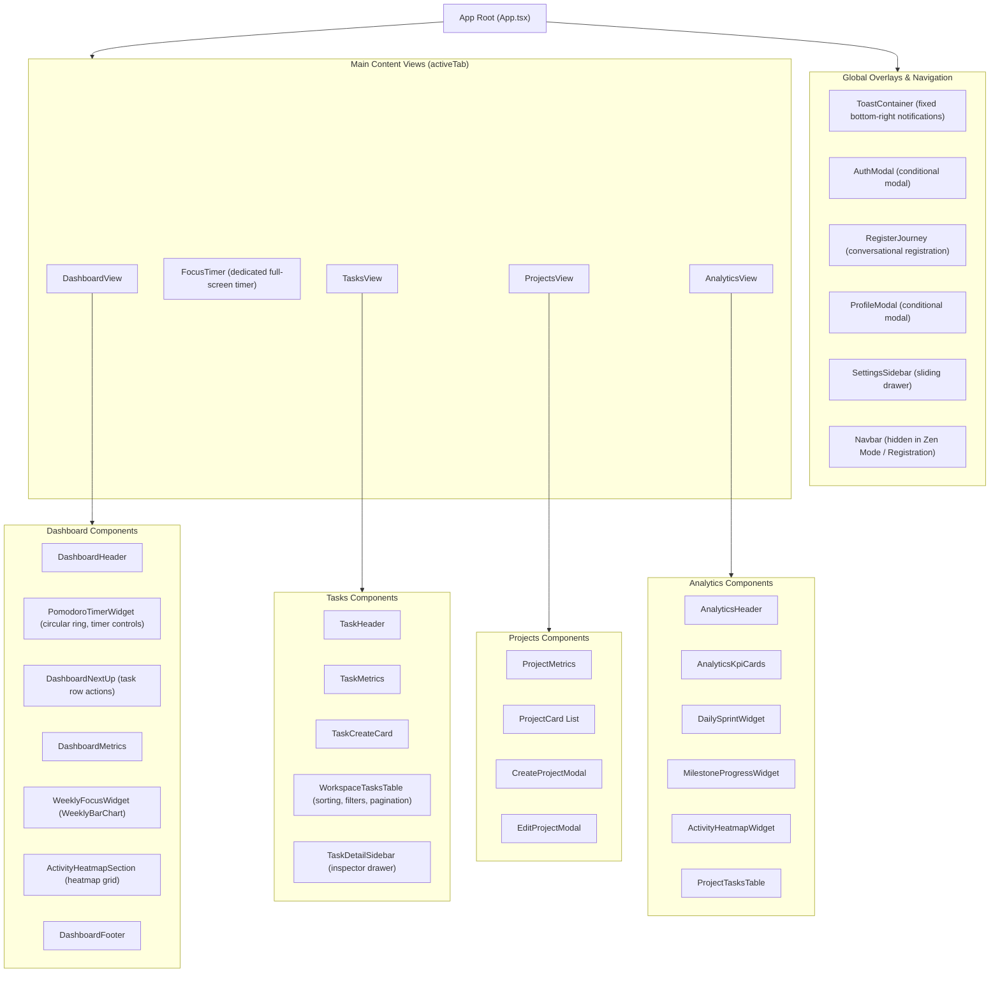

# Frontend Architecture

This document outlines the architecture, technology stack, directory organization, component hierarchy, and design paradigms of the Focus web application.

---

## Technology Stack

- Runtime & Framework: React 19
- Language: TypeScript 5.8+ (Strict Mode enabled)
- Bundler & Dev Server: Vite 8 (using Rolldown / esbuild engine)
- Styling: Tailwind CSS v4 (with `@theme`, `@utility`, and CSS variable tokens)
- State Management: Zustand 5+ (with localStorage persistence)
- Icons: Lucide React
- Visualizations: Recharts & SVG custom ring displays
- Audio Feedback: Web Audio API synthesis
- Code Quality: ESLint with React Compiler plugin support

---

## Directory Organization

The frontend codebase is located under `web/src/` and partitioned into focused domain modules:

```
web/
├── src/
│   ├── components/
│   │   ├── analytics/           # Analytics view components and metrics helpers
│   │   │   ├── ActivityHeatmapWidget.tsx
│   │   │   ├── AnalyticsHeader.tsx
│   │   │   ├── AnalyticsKpiCards.tsx
│   │   │   ├── DailySprintWidget.tsx
│   │   │   ├── MilestoneProgressWidget.tsx
│   │   │   ├── ProjectTasksTable.tsx
│   │   │   ├── analyticsUtils.ts
│   │   │   └── index.ts
│   │   ├── dashboard/           # Main dashboard widgets and utilities
│   │   │   ├── ActivityHeatmapSection.tsx
│   │   │   ├── DashboardAddTaskForm.tsx
│   │   │   ├── DashboardFooter.tsx
│   │   │   ├── DashboardHeader.tsx
│   │   │   ├── DashboardMetrics.tsx
│   │   │   ├── DashboardNextUp.tsx
│   │   │   ├── DashboardTaskRow.tsx
│   │   │   ├── DurationSelect.tsx
│   │   │   ├── WeeklyFocusWidget.tsx
│   │   │   ├── dashboardUtils.ts
│   │   │   └── index.ts
│   │   ├── heatmap/             # Pure calendar heatmap visualization component
│   │   ├── projects/            # Project cards, creation and editing modals
│   │   │   ├── CreateProjectModal.tsx
│   │   │   ├── EditProjectModal.tsx
│   │   │   ├── ProjectCard.tsx
│   │   │   ├── ProjectMetrics.tsx
│   │   │   └── index.ts
│   │   ├── tasks/               # Backlog table, sidebar details, creation cards
│   │   │   ├── EditTaskModal.tsx
│   │   │   ├── PrioritySelectDropdown.tsx
│   │   │   ├── ProjectPicker.tsx
│   │   │   ├── ProjectSelectDropdown.tsx
│   │   │   ├── TaskCreateCard.tsx
│   │   │   ├── TaskDetailSidebar.tsx
│   │   │   ├── TaskHeader.tsx
│   │   │   ├── TaskMetrics.tsx
│   │   │   ├── WorkspaceTasksTable.tsx
│   │   │   └── index.ts
│   │   ├── ui/                  # Primitives (Kbd keyboard badge, Tooltip)
│   │   │   ├── kbd.tsx
│   │   │   └── tooltip.tsx
│   │   ├── AnalyticsView.tsx    # Primary Analytics view container
│   │   ├── AuthModal.tsx        # Sign-in modal dialog
│   │   ├── DashboardView.tsx    # Primary Dashboard view container
│   │   ├── FocusTimer.tsx       # Dedicated large-format focus timer view
│   │   ├── Navbar.tsx           # Global top navigation bar
│   │   ├── PomodoroTimerWidget.tsx # Core countdown widget (ring + timer logic)
│   │   ├── ProfileModal.tsx     # Account settings and password management modal
│   │   ├── ProjectsView.tsx     # Primary Projects list view container
│   │   ├── RegisterJourney.tsx  # Multi-step conversational registration workflow
│   │   ├── SettingsSidebar.tsx  # Preferences drawer (sound, durations, zen mode)
│   │   ├── TasksView.tsx        # Primary Tasks backlog view container
│   │   ├── ToastContainer.tsx   # Minimalist bottom-right notification renderer
│   │   └── WeeklyBarChart.tsx   # Recharts weekly focus bar chart
│   ├── hooks/
│   │   └── useKeyboardShortcuts.ts # Global keyboard event listener
│   ├── services/
│   │   └── api.ts               # Axios / Fetch client wrapping REST endpoints
│   ├── store/
│   │   └── useStore.ts          # Central Zustand state management store
│   ├── types/
│   │   └── index.ts             # TypeScript interfaces for API models and UI state
│   ├── utils/
│   │   └── sound.ts             # Web Audio API sound cue synthesizer
│   ├── App.tsx                  # Root application component and view orchestrator
│   ├── index.css                # Global CSS variables, utilities, and animations
│   └── main.tsx                 # React application entry point
├── package.json                 # Node dependencies and build scripts
├── tsconfig.json                # TypeScript project configuration
└── vite.config.ts               # Vite bundler plugins and configuration
```

---

## Component Hierarchy and Tree Structure



---

## View Navigation Architecture

The application operates as a high-performance Single-Page Application (SPA) utilizing instant in-memory tab switching without full page reloads:

- Tabs: `dashboard`, `focus`, `tasks`, `projects`, `analytics`.
- Controlled via `activeTab` inside the central Zustand store (`useStore`).
- State Preservation: Active timers, countdown intervals, draft inputs, and session notes remain alive in memory when navigating between tabs.

---

## Zen Mode Architecture

Zen Mode (`isZenMode`) provides a completely distraction-free workspace for deep focus:
- Activation: Triggered via keyboard shortcut (`Z`), the settings sidebar, or timer controls.
- Visual Transformation:
  - The global top `Navbar` is unmounted smoothly.
  - Secondary sidebars, drawers, and peripheral metrics are hidden.
  - Viewports center exclusively on active work items and the countdown ring.
- Exit: Pressing `Z` or `Esc` immediately restores standard workspace navigation.
